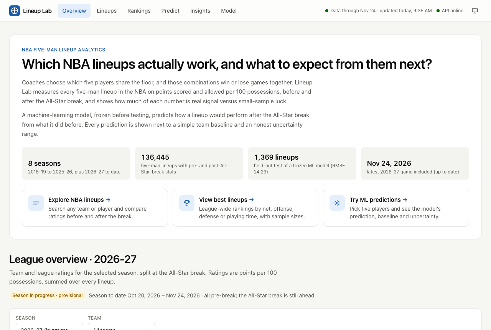
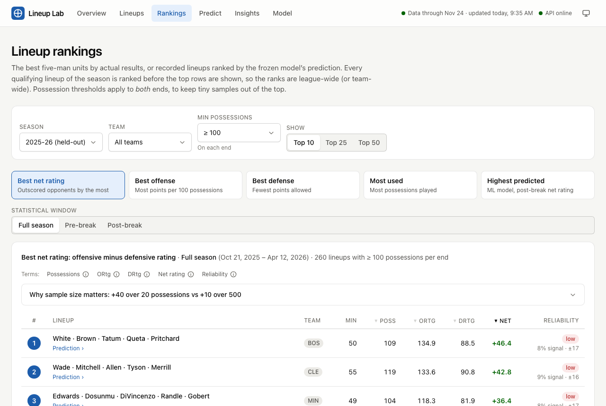
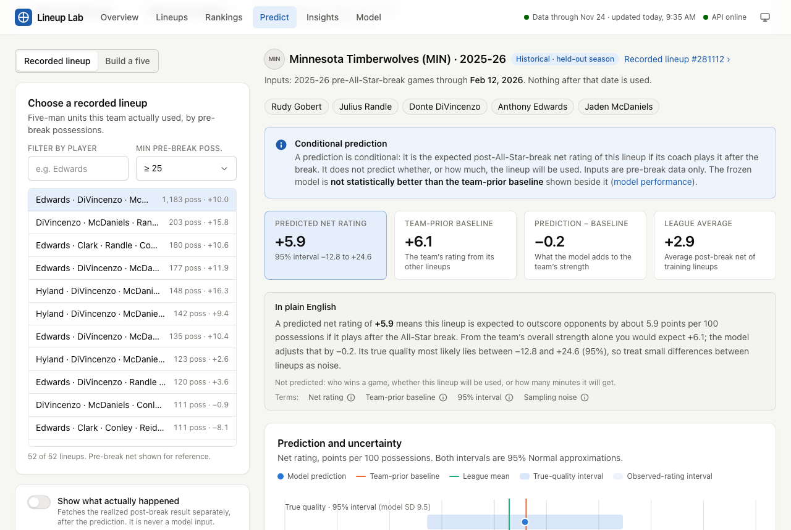
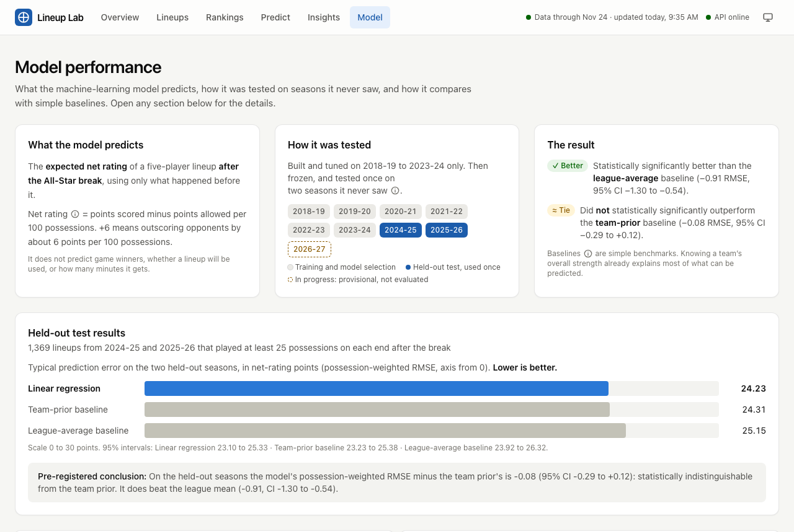
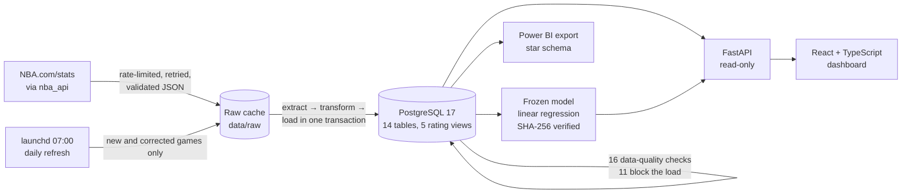

# Lineup Lab: NBA five-man lineup analytics and prediction

Lineup Lab measures how every NBA five-player lineup performed before and after the All-Star break, from 2018-19 to 2025-26 plus the 2026-27 season to date. It separates real signal from small-sample luck, and uses a frozen, honestly evaluated machine-learning model to predict how a lineup would perform after the break.

It is an end-to-end project:
- an ingestion pipeline from NBA.com stats into PostgreSQL with data-quality gates;
- statistical analysis and a chronologically validated ML model;
- a read-only FastAPI service;
- a React + TypeScript dashboard.



| Lineup rankings | Prediction Lab | Model performance |
|---|---|---|
|  |  |  |

<sub>Screenshots of the running app on real data (NBA.com/stats). Team marks are neutral abbreviation badges, because NBA logos are trademarks and aren't used. The mobile dark-mode view is in [docs/screenshots/mobile-dark.png](docs/screenshots/mobile-dark.png).</sub>

## 60-second project tour

1. **Overview: understand the data.** The landing page explains the project. It shows 9 seasons and more than 136,000 five-man lineups (the count grows with each daily refresh), and team ratings before and after the All-Star break.
2. **Rankings: find strong lineups.** Rank lineups league-wide by best net rating, best offense, best defense, most used, or highest predicted net rating.
   - Every row shows its possessions and a reliability indicator.
   - A short explainer shows why +40 over 20 possessions means less than +10 over 500.
3. **Prediction Lab: make a prediction.** Pick a team and five players, either a lineup that played together or a new combination. You get:
   - the predicted post-break net rating;
   - the team-prior baseline and the difference from it;
   - a 95% interval and the data cutoff;
   - a plain-English reading.
4. **Model performance: how the model was tested.** Trained on 2018-19 to 2023-24, frozen, then tested once on 2024-25 and 2025-26. The page shows the result against two baselines, with expandable explanations.

A 60-second interview version of this project is in [docs/interview.md](docs/interview.md).

## Key features

- **Every five-man lineup, eight full seasons plus the current one.** More than 148,000 lineup-window records. Offensive, defensive and net rating, all recomputed from summed totals and checked against NBA.com's published values.
- **Signal versus noise.** Each rating comes with its sampling standard deviation and a reliability score from an empirical-Bayes measurement model, so small samples aren't mistaken for skill.
- **Global lineup rankings.** Ranked in the database across every qualifying lineup (not just the first page). Ties share a rank. Possession thresholds apply to both ends.
- **ML predictions with honest uncertainty.** Every prediction is shown next to the team-prior baseline and two 95% intervals, and the model's limits are stated on the page.
- **Hypothetical lineups.** Score any five players from one team, even if they never played together.
- **2026-27 season to date.**
  - A local daily refresh (macOS launchd, 07:00) loads newly completed games incrementally. Re-running it creates no duplicates, and the dashboard updates without a rebuild.
  - 2026-27 predictions are labelled **provisional**, and an audit quantifies their early-season bias ([docs/partial_window_audit.md](docs/partial_window_audit.md)).
- **Responsive, accessible dashboard.** Light and dark themes, plain-English tooltips for every metric, a data table behind every chart, and loading, empty and error states.

## Technology stack

| Layer | Tools |
|---|---|
| Data ingestion | Python 3.12, `nba_api` 1.12, requests (rate-limited, retried, cached, resumable) |
| Storage | PostgreSQL 17.6 (Docker), psycopg 3, SQL views for every rating definition |
| Analysis and ML | pandas, NumPy, scikit-learn (linear regression, ridge, random forest), empirical Bayes, cluster bootstrap |
| API | FastAPI, Pydantic, read-only connection pool, OpenAPI |
| Frontend | React 19, TypeScript, Vite, Tailwind CSS v4, Recharts, TanStack Query, types generated from OpenAPI |
| Testing | pytest, Vitest + Testing Library + MSW, Playwright (desktop and mobile) |
| Scheduling | macOS launchd (local only) |
| BI | Power BI project (TMDL semantic model, PBIR report) generated in code. Not yet opened in Power BI; see Limitations |

## Architecture



## Data pipeline and PostgreSQL

- **Ingestion** (`src/nba_lineups/ingest`):
  - one request per team, window and measure, to stay under the API's silent 2,000-row cap;
  - at least 1 second plus jitter between requests, and exponential-backoff retries;
  - every payload validated before it is cached; atomic writes, so a crashed run resumes where it stopped;
  - an append-only audit log of every request.
- **All-Star break windows** are detected from the schedule gap, not hard-coded.
- **Warehouse** (`src/nba_lineups/db/schema.sql`):
  - normalized tables for seasons, teams, players, lineups, lineup members, games, and lineup, player and team window stats;
  - CHECK constraints enforce basketball arithmetic (for example, points = 2·FGM + 3PM + FTM);
  - ratings are defined once, in SQL views, as aggregate-then-divide.
- **ETL** (`src/nba_lineups/etl`):
  - each season loads in **one transaction**, upserting dimensions and replacing facts, so reloads are idempotent;
  - 16 data-quality checks run inside that transaction; the 11 error-level checks roll the whole season back on failure. Examples: lineup points reconcile with game-log points; every game falls in exactly one window; recomputed ratings equal NBA.com's published ones.
  - Exact opponent possessions are recovered from published pace (docs/metrics.md).
- **Daily refresh** (`src/nba_lineups/refresh`):
  - fingerprints each team's box scores and refetches only teams with new or corrected games, plus a weekly full sweep;
  - a file lock and a database advisory lock prevent overlapping runs;
  - the database is checked before any NBA request;
  - games after the data cutoff are never loaded.

Details: [docs/ingestion.md](docs/ingestion.md), [docs/database.md](docs/database.md), [docs/metrics.md](docs/metrics.md), [docs/refresh.md](docs/refresh.md).

## Machine-learning methodology

- **Target:** a lineup's net rating after the All-Star break (points scored minus allowed per 100 possessions). The sample is lineups with at least 25 post-break possessions on each end, weighted by possessions. The prediction is **conditional**: how the lineup would play *if* used, not whether or how much it is used.
- **Inputs:** pre-break data only. There are 16 engineered features, 11 of which survive collinearity pruning. They cover team strength from the team's *other* lineups, players' empirical-Bayes-shrunk on-court ratings, on-off and usage, the lineup's own shrunk history, and rotation and history indicators. A test proves the fitted parameters don't change when validation data changes.
- **Leakage controls:**
  - the held-out seasons can only be read with a key that is issued after the model file is frozen, hashed and committed to git;
  - feature queries are tested to touch only pre-break rows.
- **Validation:** nested, expanding-window (chronological) cross-validation on 2018-19 to 2023-24. Training only on the past is what prevents future-data leakage.
- **Model selection:** linear regression, ridge and random forest were compared under a rule fixed in advance: the simplest model within one standard error of the best. Linear regression had the lowest cross-validated RMSE (21.73, against 21.80 for random forest and 21.81 for ridge) and is the simplest, so it was chosen and frozen.
- **Final test:** run once, on 2024-25 and 2025-26, with a team-season cluster bootstrap for 95% confidence intervals.

Details: [docs/features_baselines.md](docs/features_baselines.md), [docs/modeling.md](docs/modeling.md), [docs/model_card.md](docs/model_card.md).

## Verified model evaluation results

These are held-out results, pooled over 2024-25 and 2025-26: 1,369 lineups, with RMSE in net-rating points, possession-weighted. **Lower RMSE is better.** They are served live by `GET /api/v1/model/performance` from the frozen evaluation reports.

| Method | RMSE | 95% CI |
|---|---|---|
| **Linear regression (frozen model)** | **24.23** | 23.10 to 25.33 |
| Team-prior baseline (the team's rating from its other lineups) | 24.31 | 23.23 to 25.38 |
| League-average baseline (the same prediction for every lineup) | 25.15 | 23.92 to 26.32 |
| Noise floor (the error of a perfect model) | 22.27 | 21.66 to 22.87 |

- **The model significantly outperformed the league-average baseline.** The RMSE difference is −0.91, with a 95% CI of −1.30 to −0.54.
- **The model did *not* statistically significantly outperform the team-prior baseline.** The difference is −0.08, with a 95% CI of −0.29 to +0.12, which includes zero.
- R² is 0.070, against a ceiling of 0.214 that is set by sampling noise. Post-break lineup ratings over a few hundred possessions are mostly noise, and once a team's overall strength is known, little lineup-specific signal remains. The model is useful for noise-aware expectations and within-team comparisons, not for claims that a lineup "is" +X.

## Run it locally (macOS)

Requirements: Python 3.12, Node 20+, Docker Desktop.

```bash
python3 -m venv .venv && .venv/bin/pip install -e ".[dev]"
cp .env.example .env                          # set a database password
docker compose up -d                          # PostgreSQL 17.6 on 127.0.0.1:5432

# Data (run from a home network; stats.nba.com blocks most cloud IPs)
.venv/bin/python -m nba_lineups.ingest --seasons 2018-19 2019-20 2020-21 2021-22 2022-23 2023-24 2024-25 2025-26
.venv/bin/python -m nba_lineups.etl          # raw JSON -> PostgreSQL (idempotent)
.venv/bin/python -m nba_lineups.refresh      # 2026-27 season to date (optional)

# API and dashboard (two terminals)
.venv/bin/uvicorn nba_lineups.api.main:app --port 8000          # http://127.0.0.1:8000/docs
cd web && npm install && cp .env.example .env.local && npm run dev   # http://localhost:5173
```

Optional:
- `scripts/refresh/install_schedule.sh` enables the daily 07:00 refresh; check it with `scripts/refresh/schedule_status.sh` ([docs/refresh.md](docs/refresh.md)).
- The Phase 4–6 analysis and model scripts are in `scripts/`. The frozen model is committed in `models/final/`, so you don't need to retrain anything to use the app.

## Testing and validation

| Suite | What it covers |
|---|---|
| `pytest` (Python) | Pipeline, validation and retries offline; ETL and data-quality checks on throwaway databases; metric reconciliation with NBA.com; leakage guards; model freeze integrity; held-out metrics reproduced from the warehouse; every API endpoint against the real warehouse; global ranking order versus SQL; refresh scenarios (incremental loads, re-runs, corrections, postponed games, timeouts, database downtime, overlapping runs); provisional-prediction leakage and reproducibility |
| `npm test` (Vitest) | Components and pages on fixtures recorded from the live API, including tooltips, rankings, predictions and freshness |
| `npm run test:integration` | The app's typed client against the live API, including OpenAPI drift |
| `npm run test:e2e` (Playwright) | Key displayed values checked against the live API on every page, the main user flows (navigation, ranking, prediction, provisional notices), and no horizontal scroll at phone width |

TypeScript type-checking, the production build and lint run with `npm run build` and `npm run lint`. Current totals are in [docs/dashboard.md](docs/dashboard.md) and the commit log.

## Limitations and future improvements

- **The model ties the team-prior baseline.** The target is dominated by sampling noise. Play-by-play data (opponent quality, garbage time) could add signal; that is future work.
- **2026-27 predictions are provisional.** They use a partial pre-break window, run about 2 points low early in the season, and don't beat the team prior at this stage ([audit](docs/partial_window_audit.md)).
- **Local only.** The app isn't deployed. NBA.com's terms allow private, non-commercial use with attribution, but not a public, regularly updated statistics database without consent, so any public version would need a different data arrangement.
- **Power BI:** the star schema, semantic model (65 DAX measures) and 5-page report are generated and validated against Microsoft's schemas and the warehouse. They haven't been opened in Power BI yet, because Power BI Desktop is Windows-only and the Service needs a work or school account ([docs/powerbi.md](docs/powerbi.md)).
- **The daily refresh runs only while the Mac is awake.** It catches up after sleep or shutdown.

## Data and attribution

Statistics come from [NBA.com/stats](https://www.nba.com/stats) through the open-source [`nba_api`](https://github.com/swar/nba_api) client. This is a personal, non-commercial educational project. Raw data isn't committed to this repository. NBA data is owned by the NBA and subject to the [NBA.com Terms of Use](https://www.nba.com/terms).

## Documentation

| Doc | Contents |
|---|---|
| [docs/phase0_data_report.md](docs/phase0_data_report.md) | Data availability, the API row cap, selection bias |
| [docs/ingestion.md](docs/ingestion.md) · [docs/database.md](docs/database.md) · [docs/metrics.md](docs/metrics.md) | Pipeline, schema, data-quality checks, rating definitions |
| [docs/eda_reliability.md](docs/eda_reliability.md) · [docs/features_baselines.md](docs/features_baselines.md) | Reliability analysis, features, baselines |
| [docs/modeling.md](docs/modeling.md) · [docs/model_card.md](docs/model_card.md) | Model selection, held-out test, model card |
| [docs/api.md](docs/api.md) · [docs/dashboard.md](docs/dashboard.md) | API and dashboard |
| [docs/refresh.md](docs/refresh.md) · [docs/partial_window_audit.md](docs/partial_window_audit.md) | 2026-27 daily refresh, and the provisional-prediction audit |
| [docs/powerbi.md](docs/powerbi.md) | Power BI workflow and validation |
| [docs/interview.md](docs/interview.md) | 60-second explanation and likely interview questions |
